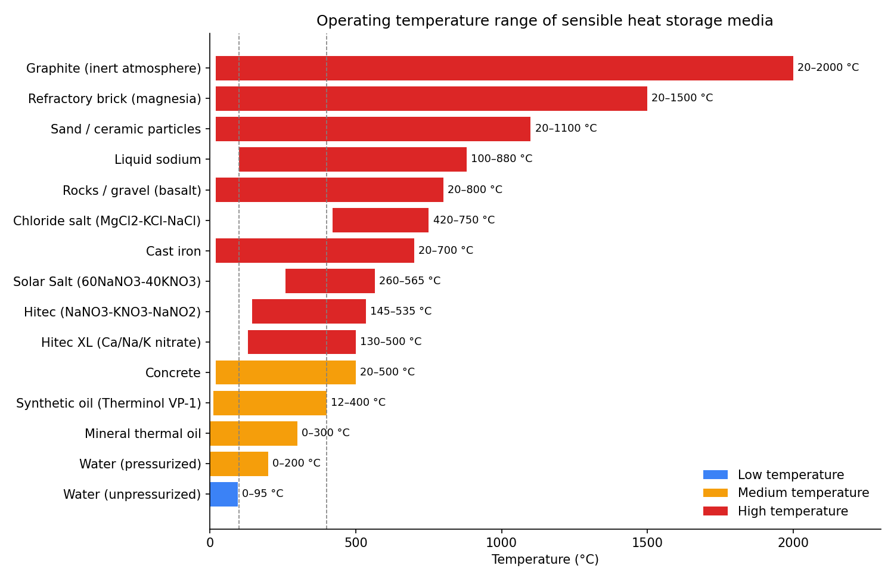
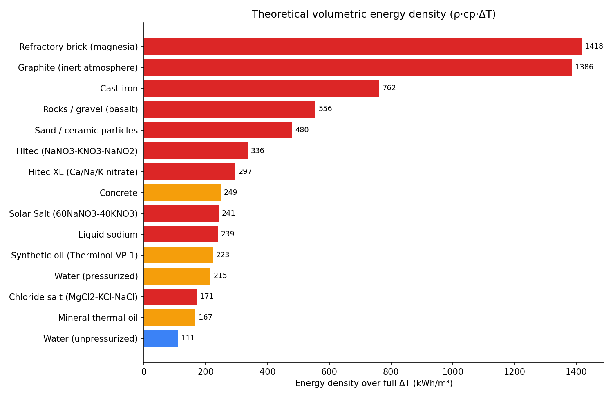
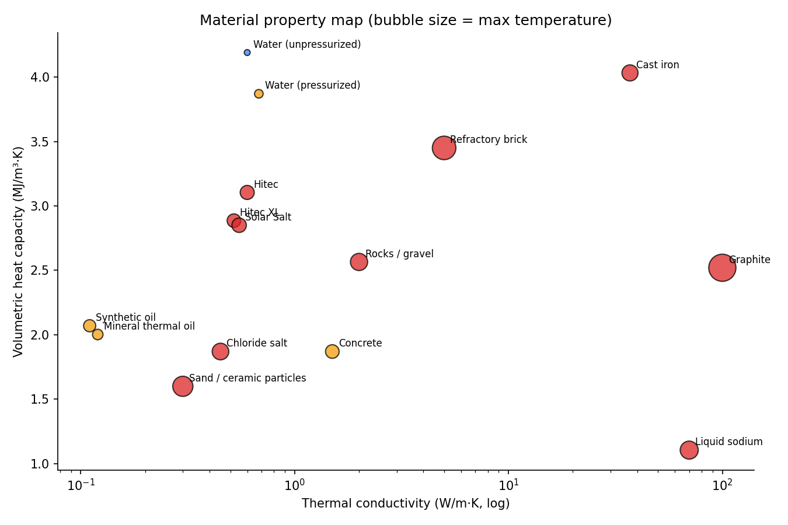
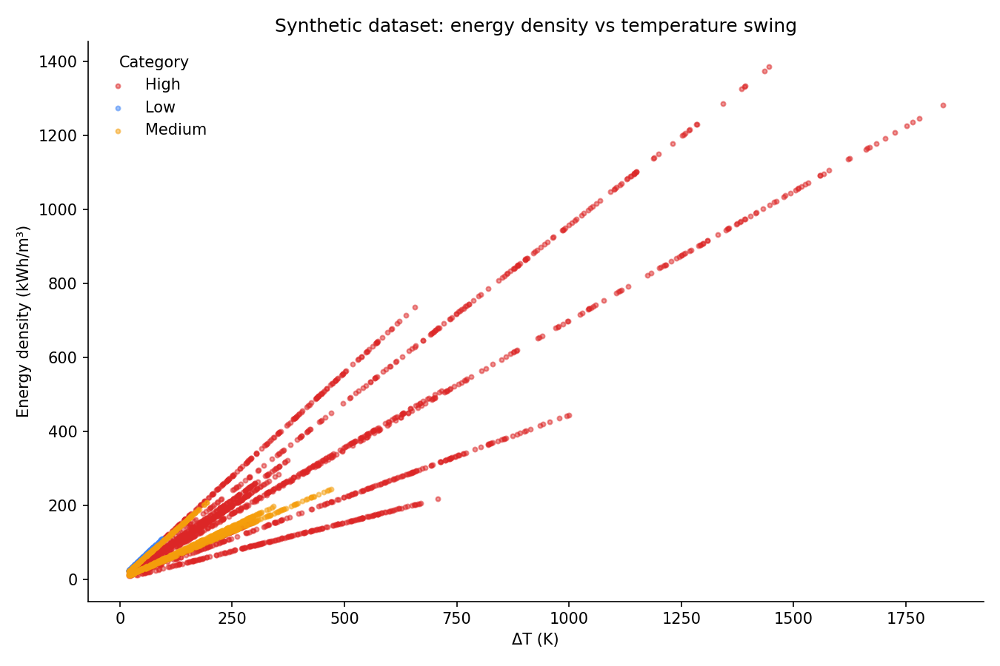
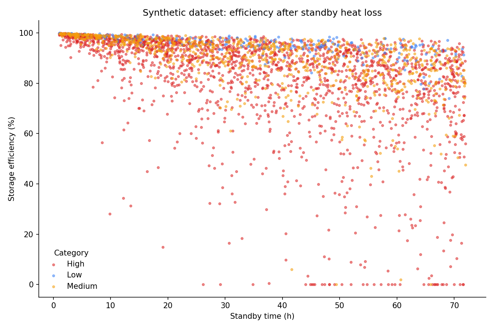

# Sensible Heat Storage (SHS) Dataset

Datasets and visualizations of sensible heat storage media, covering operating temperatures from **0 °C to ~2000 °C**.

## Contents

| Path | Description |
|---|---|
| `data/shs_materials.csv` | 15 SHS media with temperature range, density, specific heat, conductivity, approx. cost and limiting mechanism |
| `data/shs_synthetic_dataset.csv` | 3,000 synthetic storage cases (200 per medium): stored energy, standby heat loss, efficiency |
| `scripts/generate_dataset.py` | Regenerates the synthetic dataset |
| `scripts/make_plots.py` | Regenerates all plots |
| `plots/` | PNG figures (shown below) |

## Temperature classes

- **Low (< 100 °C):** water
- **Medium (100–400 °C):** pressurized water, thermal oils, concrete
- **High (> 400 °C):** molten salts, metals, rocks, sand, ceramics, graphite

## Plots

### Operating temperature ranges


### Theoretical volumetric energy density (ρ·cp·ΔT)


### Material property map


### Synthetic dataset: energy density vs ΔT


### Synthetic dataset: efficiency after standby


## Synthetic model

For each case the storage volume, temperature window, insulation U-value, ambient temperature and standby time are sampled at random within the medium's limits.

- Stored energy: `Q = m · cp · (T_high − T_low)`
- Standby loss: lumped first-order cooling of a cubic tank, `T(t) = T_amb + (T_high − T_amb) · exp(−t/τ)`, with `τ = m·cp / (U·A)`
- Efficiency: usable energy remaining above `T_low` divided by `Q`

The model ignores stratification, thermocline and internal conduction effects, so it is intended for screening and ML prototyping, not detailed design.

## Usage

```bash
pip install pandas numpy matplotlib
python scripts/generate_dataset.py
python scripts/make_plots.py
```

## Data notes

Property values are typical literature figures at mid-range temperature. Real limits and properties vary by supplier, purity and container design, and costs are rough order-of-magnitude estimates. Verify against primary sources before using the data in design work.
